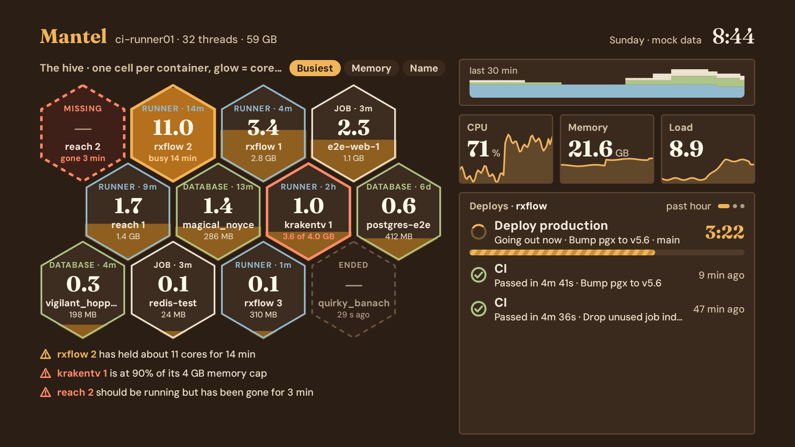
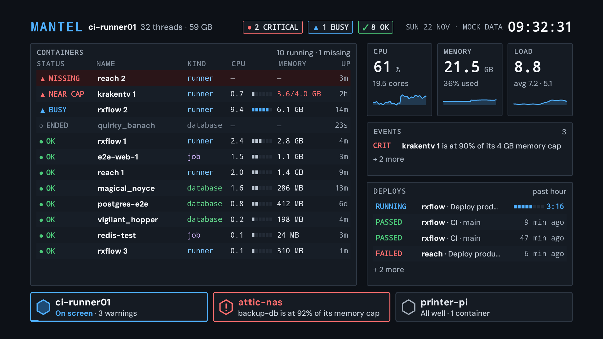
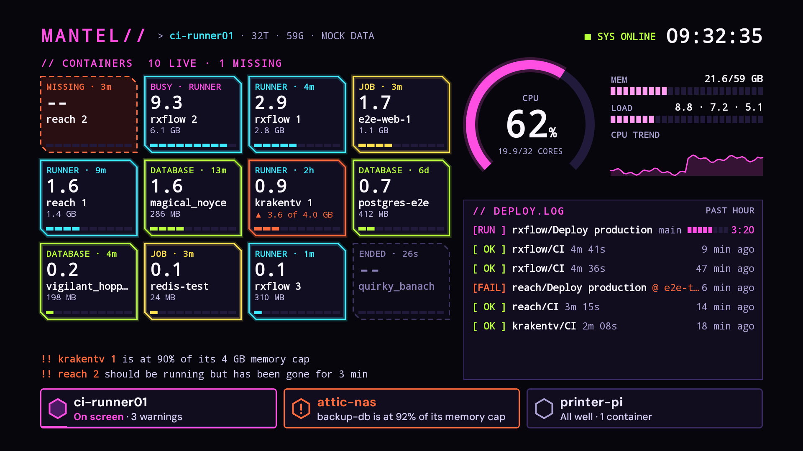

# Mantel

An always-on Android TV wall display for a home CI box. From across the room it answers two questions: is the machine struggling, and did my last deploy go out?

Mantel is open source (Apache 2.0) and read-only. It cannot start, stop or change a container, a machine or a workflow.

## What it shows

- **The hive.** One hexagon per container on the machine, from [Glances](https://nicolargo.github.io/glances/). The glow in a cell is how many cores it is using, and the line under the name is its memory. Runners, job databases and job containers have their own outline color and word. A container that ended lingers for a minute, and a runner that should be there and is not shows as "missing".
- **Warnings.** Up to three plain sentences under the hive, such as a container near its memory cap or a missing runner.
- **The machine.** How many containers are running and of which kind over the last 30 minutes, then CPU, memory and load, each with a small trend.
- **Deploys.** GitHub Actions runs from the repositories you choose. Runs that are going show a timer and a progress bar; finished ones show passed or failed, and which job failed. While anything ran in the last hour the card shows only that; otherwise it shows each repository's latest runs, one repository at a time.
- **Several machines.** With more than one machine the display shows one at a time and takes turns. A shelf along the bottom has a plaque for each, which says if another machine has a problem or has stopped answering.

If the machine stops answering, the screen dims to its last reading and says for how long.

## What you need

- An Android TV or Fire TV, 1080p, Android 8 or later.
- [Glances](https://nicolargo.github.io/glances/) running in web server mode on each machine you want to watch, on the same network as the TV, with no password.
- For deploys, a GitHub account. This part is optional.

Mantel is not in an app store yet. For now you build it and install it with adb; see [Build](#build).

## Set up a display

A freshly installed Mantel sets itself up on the TV with the remote. Nothing about your network or your GitHub account is in the APK.

### 1. Start Glances on each machine

Install Glances by following [its documentation](https://nicolargo.github.io/glances/), then start it with its web page on:

```bash
glances -w
```

It listens on port 61208. Container stats need Glances to be able to see Docker or Podman on that machine.

### 2. Choose machines on the TV

Open Mantel. It asks the 254 addresses that share the TV's first three numbers whether Glances answers on port 61208, and shows each machine that does as a cell. The search only opens a connection and reads.

- Press OK on the cells you want, then "Watch N machines".
- If a machine is on another network or port, choose "Enter an address" and type it on the number pad.
- If nothing answers, the screen says how to start Glances, shows a QR code to its documentation and keeps looking every 10 seconds.
- A machine that answers on two addresses, for example wired and wireless, shows as two cells. Pick one.

### 3. Sign in to GitHub (optional)

The TV shows a short code and a QR code.

1. Scan the QR code with a phone, or open `github.com/login/device` on any computer.
2. Type the code from the TV and approve.
3. Choose which repositories Mantel may read at [github.com/apps/mantel-ci-cd-display](https://github.com/apps/mantel-ci-cd-display): install the app on your account or organization and pick the repositories. The TV waits on a "no repositories yet" screen until you do, and moves on by itself.

Signing in gives Mantel read access to Actions and Metadata for the repositories you choose, and nothing else. No password or token is typed on the TV. The sign-in is stored encrypted on the TV and renewed by itself.

"Skip" leaves the deploys card on sample runs, and the header says "sample deploys".

### 4. Start

The last screen lists the machines and repositories. Press "Start".

## Settings

On the live display, press the Menu button on the remote, or hold OK for about a second.

- **Machines:** see each machine and whether it is answering. Remove one, or choose "Add a machine" to search the network again.
- **Look:** the main screen's layout (Hive, NOC or Neon) and its color theme. The display changes at once. See [Layouts and themes](#layouts-and-themes).
- **Deploys:** see who is signed in and which repositories are read. "Choose repositories" brings back the QR code to the app's page on GitHub; repositories are chosen there, not on the TV. You can also sign in or sign out.
- **Start over:** forgets everything this display stores and shows setup again.

"Start over" also goes back to the Hive layout and theme. "Remove", "Sign out" and "Start over" ask once: press OK a second time to confirm. Signing out makes the TV forget the sign-in; to end the authorization itself, revoke it in your GitHub settings.

Changing repositories on GitHub reaches the display within 10 minutes. With more than 12 repositories, Mantel watches the 12 most recently pushed.

## Set up with a config file instead

For development, or to use a personal access token rather than the sign-in. A pushed file replaces everything the display has stored, including a sign-in made on the TV.

1. Write `mantel-config.json`. Keep it out of version control: it holds a token.

   ```json
   {
     "glancesUrl": "http://192.168.1.50:61208",
     "githubToken": "github_pat_...",
     "repos": ["owner/name"]
   }
   ```

   - `glancesUrl` is the machine running `glances -w`. Use an IP address: most TVs cannot resolve `.local` names.
   - To watch several machines, replace `glancesUrl` with a list: `"glancesUrls": ["http://192.168.1.50:61208", "http://192.168.1.61:61208"]`.
   - `githubToken` and `repos` are optional and go together. Use a fine-grained personal access token limited to those repositories, with read-only access to Actions and Metadata and nothing else.

2. Push it to the TV. adb cannot write straight into an app's storage on Android 11 and later, so this takes two commands:

   ```bash
   adb push mantel-config.json /data/local/tmp/
   ```

   ```bash
   adb shell run-as com.blayter.mantel cp /data/local/tmp/mantel-config.json files/
   ```

3. Delete the copy afterwards:

   ```bash
   adb shell rm /data/local/tmp/mantel-config.json
   ```

Mantel looks for the file every few seconds, stores its contents encrypted, deletes the file and starts. If the file cannot be used, the setup screen says why; once machines are being watched, a rejected file is not reported on screen. If the TV cannot encrypt, the token is not stored at all and the deploys card says so.

`run-as` needs a debug build. On a release build, copy the file to `/sdcard/Android/data/com.blayter.mantel/files/` with a file manager instead.

## What Mantel sends over the network

- **To your machines:** GET requests to Glances (`/api/4/containers`, `/quicklook`, `/mem`, `/load`, `/system`) every few seconds, and during setup one connection attempt to port 61208 on each address of the TV's own network.
- **To GitHub:** GET requests for workflow runs, the jobs of a failed run, who is signed in and which repositories the app may read. Signing in and renewing the sign-in are the only POST requests; they change nothing in any repository or workflow.

Nothing is sent anywhere else. There is no analytics and no account with Mantel.

## Known limits

- A Glances that asks for a password cannot be watched yet.
- The rules for what counts as a runner, which runners are expected and how names are shortened still describe the author's own CI box. They need a general form before a store release.
- Only the first machine has expected runners, so only it can show "missing" cells.
- The warning thresholds (memory near its cap at 85%, sustained CPU, host CPU at 90%) are provisional.
- There is no drill-in screen for a single run or container.
- Glances keeps no history, so the trends start empty each time the app starts or its settings change.

## Build

You need JDK 17 and the Android SDK (platform 35, build-tools 35.0.0).

1. Point the build at your SDK in `local.properties` (not checked in):

   ```
   sdk.dir=/path/to/android/sdk
   ```

2. `gradle.properties` pins `org.gradle.java.home` to a Homebrew JDK 17 on macOS. On another machine, change that line or override it:

   ```bash
   ./gradlew -Dorg.gradle.java.home=/path/to/jdk17 :app:assembleDebug
   ```

3. Run the unit tests:

   ```bash
   ./gradlew :app:testDebugUnitTest
   ```

4. Install on the TV or emulator that adb is connected to:

   ```bash
   ./gradlew :app:installDebug
   ```

Always use the wrapper (`./gradlew`); a newer system Gradle may run on a JDK this Android plugin does not support.

To work on the screen without a Glances machine, build the all-mock app, which opens on the design's sample screen:

```bash
./gradlew :app:installDebug -Pmantel.mock=true
```

Add `-Pmantel.mockMachines=3` for sample machines and the shelf.

To try it without a TV, create an Android TV emulator with the `tv_1080p` device profile and install onto it.

If you fork Mantel and want your own GitHub App for the sign-in, register one with "Enable Device Flow" ticked and read-only access to Actions and Metadata, then put its client ID and page in `app/src/main/java/com/blayter/mantel/data/github/GitHubAuth.kt`. The client ID is public; there is no client secret.

## Layouts and themes

The main screen comes in three **layouts**:

| Hive (default) | NOC | Neon |
| --- | --- | --- |
|  |  |  |
| Honeycomb cells and warm cards. | A network-operations wall: counts by severity, every container in a table, an event list. | Cyberpunk: neon-outlined tiles, a CPU ring, a deploy log. |

Each layout has its own color **themes**:

- **Hive:** Hive, Moss, Nightfall.
- **NOC:** NOC, Amber Ops, High Contrast, Solar.
- **Neon:** Neon, Synthwave, Ice, Phosphor.

Screenshots of every NOC and Neon theme are in
[`docs/design/layouts/previews`](docs/design/layouts/previews). Choose both in settings (the Look
card), or from a computer with adb by the theme's id:

```bash
adb shell am start -n com.blayter.mantel/.MainActivity --es theme neon
```

Every layout keeps the same rules: readable from across the room with no
interaction, status in words as well as color, no large bright areas, and
read-only. [`docs/design/layouts/README.md`](docs/design/layouts/README.md)
describes each layout and how to add one.

A theme is one JSON file in [`docs/design/themes`](docs/design/themes) that
names its layout, and every file there is built in. To make your own:

- **By hand:** copy the theme of the layout you want
  ([`nightfall.json`](docs/design/themes/nightfall.json),
  [`noc.json`](docs/design/themes/noc.json) or
  [`neon.json`](docs/design/themes/neon.json)) to
  `docs/design/themes/<id>.json` and change the colors. The guide,
  [`docs/design/themes/README.md`](docs/design/themes/README.md), explains
  every color role and the rules a theme must meet (a dark ground and
  readable text); [`theme.schema.json`](docs/design/themes/theme.schema.json)
  lets your editor check the file as you type.
- **With Claude Code or Claude Design:** paste
  [`docs/design/themes/PROMPT.md`](docs/design/themes/PROMPT.md), name the
  layout and describe the look you want.
- **Check it:** open [`preview.html`](docs/design/themes/preview.html) in a
  browser and load the file to see it on a sample of its layout, or run `./gradlew :app:generateHiveTokens`,
  which lists every problem. Then try it on a TV or emulator with the adb
  command above.

New themes are welcome by pull request: see
[Submit a theme](docs/design/themes/README.md#submit-a-theme). New layouts
are code and start with an issue and a mockup: see
[Add a new layout](docs/design/layouts/README.md#add-a-new-layout). Both are
summed up in [`CONTRIBUTING.md`](CONTRIBUTING.md).

## Design

The design language is called Hive: a warm walnut palette, honeycomb container cells, craftsman-style cards, and the Fraunces and DM Sans typefaces. It is written up in [`docs/design/DESIGN.md`](docs/design/DESIGN.md), with its sizes in [`docs/design/tokens.json`](docs/design/tokens.json), its colors in [`docs/design/themes/hive.json`](docs/design/themes/hive.json) and the approved screens in [`docs/design/mockups`](docs/design/mockups).

## Licenses

Mantel is under the [Apache License 2.0](LICENSE). Fraunces and DM Sans are bundled under the SIL Open Font License; the license texts are in [`licenses/`](licenses/). QR codes are drawn with ZXing (Apache License 2.0).
